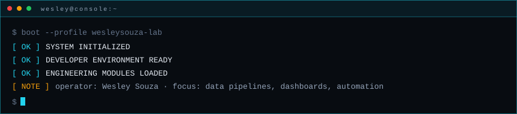

<!-- Profile README for github.com/wesleysouza-lab/wesleysouza-lab. See CUSTOMIZE.md. Items marked TODO are placeholders. -->

<div align="center">
  
</div>


## `// 01 · OPERATOR PROFILE`

<table>
<tr>
<td valign="top" width="60%">

```text
ID ............ Wesley Souza
HANDLE ........ @wesleysouza-lab
UNIT .......... AI & Technology team · RBBR
ROLE .......... TODO: your title
BASE .......... Brazil (UTC-3)
LANGUAGES ..... Portuguese (native) · English (technical)
```

I build the data and automation layer that turns operational systems into
decisions: pipelines, APIs and dashboards. I like boring, verifiable
engineering: tests first, small PRs and no secrets in code.

**Specialties:** data pipelines · BigQuery · FastAPI services · internal dashboards · AI-assisted workflows

[](https://www.linkedin.com/in/TODO)
[](mailto:wesley.souza@rbbr.com.br)
[](https://TODO.example.com)

</td>
<td valign="top" width="40%" align="center">

</td>
</tr>
</table>


## `// 02 · SYSTEM CONSOLE`




## `// 03 · NEURAL NETWORK · TECH STACK`

<!-- TODO: remove anything you do not actually use. -->

| Module | Technologies |
|:--|:--|
| **Programming languages** |    |
| **Frontend engineering** |    |
| **Backend systems** |    |
| **Databases** |   |
| **DevOps & infrastructure** |    |
| **Tools & workflow** |  -0b1118?style=flat-square&logo=linux&logoColor=22d3ee&color=22d3ee)   |


## `// 04 · SYSTEM ARCHITECTURE`



<sub>Generic flow of the systems I work on. Internal repositories are private, so details are omitted on purpose.</sub>

<details>
<summary><code>INSPECT MODULE</code> · click a stage to expand</summary>
<br>

<details>
<summary><b>01 · Sources</b> <code>SAP HANA · APIs · Sheets</code></summary>
<br>Operational data comes from the ERP (SAP HANA), partner APIs and spreadsheets. Every source is read with the least access it needs, and credentials live in a secret manager, never in code.
</details>

<details>
<summary><b>02 · Ingest</b> <code>Python · Poetry · Cloud Run</code></summary>
<br>Each job is an independent Poetry project with its own <code>src/</code> and <code>tests/</code>, deployed to Cloud Run. Jobs validate external input before writing anything.
</details>

<details>
<summary><b>03 · Store</b> <code>BigQuery</code></summary>
<br>Data moves through layers: <code>raw</code> keeps what arrived, <code>core</code> cleans and models it, <code>dm</code> serves each business question.
</details>

<details>
<summary><b>04 · Serve</b> <code>FastAPI · Cloud Run</code></summary>
<br>Small FastAPI services expose the data to the interfaces, with authentication in front and one responsibility per service.
</details>

<details>
<summary><b>05 · Interface</b> <code>Dashboards</code></summary>
<br>Internal dashboards for operations teams. Front-end changes are checked with browser tests (Playwright) before they count as verified.
</details>

<details>
<summary><b>CI · Quality gate</b> <code>ruff · tests · secrets scan</code></summary>
<br>Every pull request is checked on the lines it changes: lint, tests with at least 80% coverage, secret scanning and complexity. A human decides every merge.
</details>

<details>
<summary><b>AI agents</b> <code>Claude Code</code></summary>
<br>Agents prepare changes and run checks. People review and decide.
</details>

</details>


## `// 05 · ACTIVE PROJECTS`

<!-- TODO: replace with public repos. Do not list private or employer-internal code. -->

<table>
<tr>
<td valign="top" width="33%">
<br>
<code>PRJ-001</code> · <b>TODO project name</b><br>
<sub>One-line description of what it does and for whom.</sub><br>
<sub><code>Python</code> <code>FastAPI</code></sub><br>
<sub>🟢 active · <a href="https://github.com/wesleysouza-lab/TODO">repo</a></sub>
</td>
<td valign="top" width="33%">
<br>
<code>PRJ-002</code> · <b>TODO project name</b><br>
<sub>One-line description of what it does and for whom.</sub><br>
<sub><code>Python</code> <code>BigQuery</code></sub><br>
<sub>🟡 in progress · <a href="https://github.com/wesleysouza-lab/TODO">repo</a></sub>
</td>
<td valign="top" width="33%">
<br>
<code>PRJ-003</code> · <b>TODO project name</b><br>
<sub>One-line description of what it does and for whom.</sub><br>
<sub><code>JavaScript</code> <code>HTML</code></sub><br>
<sub>⚪ planned · <a href="https://github.com/wesleysouza-lab/TODO">repo</a></sub>
</td>
</tr>
</table>


## `// 06 · GITHUB TELEMETRY`

<div align="center">

<a href="https://github.com/wesleysouza-lab"></a>

</div>

<details>
<summary><code>ACTIVITY HISTORY</code> (expand)</summary>
<br>


<sub>These cards come from public third-party services and can be slow or offline. If they are, the alt text is shown and nothing breaks. For a version with no external dependency, see "Telemetry without third parties" in CUSTOMIZE.md.</sub>

</details>


## `// 07 · SIMULATION DECK`

<!-- Generated daily by .github/workflows/pacman.yml from your real contributions. Empty until the first run. -->

<div align="center">
  
</div>

<sub>Pac-Man plays on my real contribution graph. It is generated by a scheduled GitHub Action, not a live feed.</sub>


## `// 08 · COMMUNICATION PROTOCOL`

| Channel | Address |
|:--|:--|
| LinkedIn | [TODO](https://www.linkedin.com/in/TODO) |
| Email | [wesley.souza@rbbr.com.br](mailto:wesley.souza@rbbr.com.br) |
| Portfolio | [TODO](https://TODO.example.com) |
| GitHub | [@wesleysouza-lab](https://github.com/wesleysouza-lab) |

<div align="center">

<sub><code>SYSTEM STANDING BY</code></sub>

</div>
