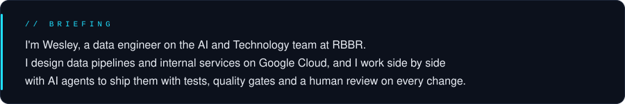
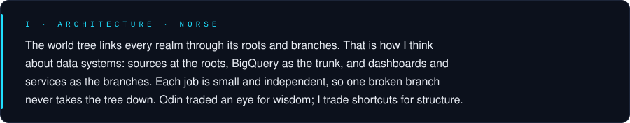
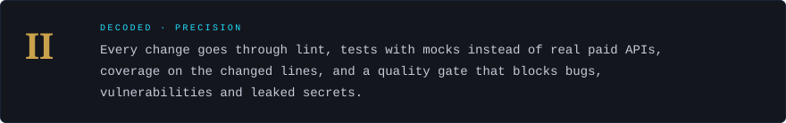
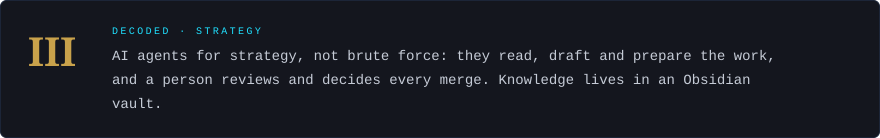
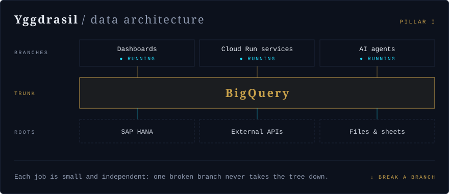
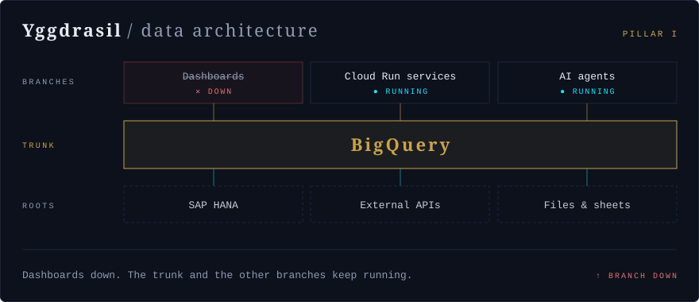
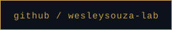

<!-- Wesley Souza | Ancient Wisdom, Modern Code | layout from Claude Design "Profile README" -->

  

  

  
  
  

  

  

  

  
  

  

<!-- FEATURED PROJECTS: when you have a public repo, add one card per repo here:

  

-->

  

  
  
  <!-- LINKEDIN: uncomment and replace LINKEDIN_HANDLE
  
  -->

