  

I'm Wesley, a data engineer on the AI and Technology team at RBBR, in Brazil.
I build data pipelines and internal tools on Google Cloud, working side by side with AI agents.

  

  

### Loaded modules

`Python` `SQL` `BigQuery` `Cloud Run` `Docker` `FastAPI` `Poetry` `pytest` `Ruff` `GitHub Actions` `Claude Code` `Obsidian`

### Current focus

Building a logistics control tower, one module at a time.

### Say hello

Open an issue, or just wave. The channel is open.
