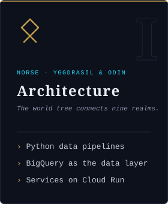
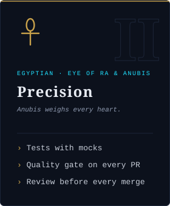
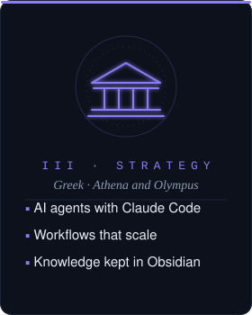
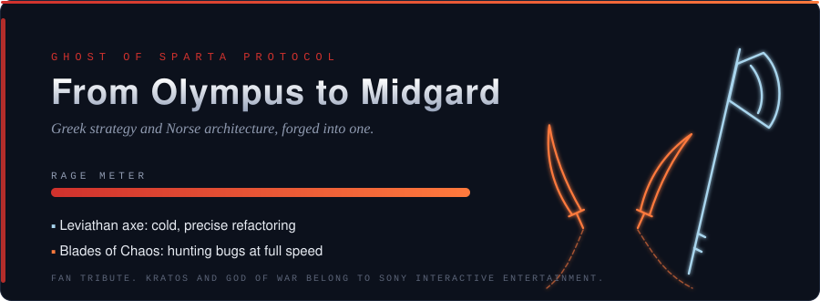
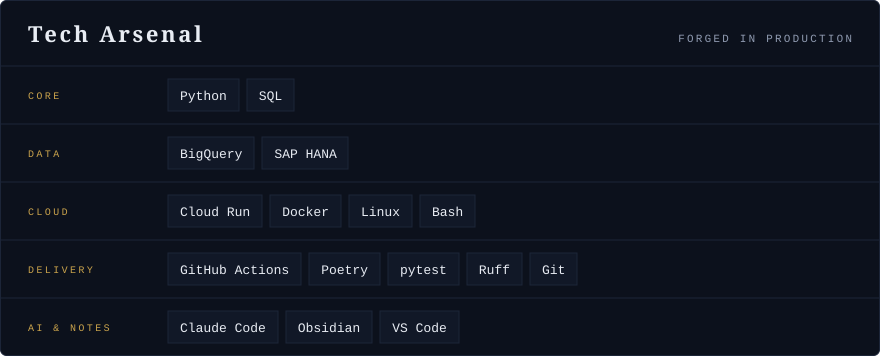

<!-- MYTHOS.exe | Ancient Wisdom, Modern Code -->

  

  

  
  
  
  

<h3 align="center">Developer Introduction</h3>

  I'm Wesley, a data engineer on the AI and Technology team at RBBR.
  I design data pipelines and internal services on Google Cloud, and I work side by side with AI agents
  to ship them with tests, quality gates and a human review on every change.

<h3 align="center">The Three Pillars</h3>

  
  
  

Click a pillar to decode it.

<b>I · Architecture</b> · Yggdrasil connects nine worlds

The world tree links every realm through its roots and branches. That is how I think about data systems:
sources at the roots, BigQuery as the trunk, and dashboards and services as the branches.
Each job is small and independent, so one broken branch never takes the tree down.
Odin traded an eye for wisdom; I trade shortcuts for structure.

<b>II · Precision</b> · Anubis weighs every heart

In the hall of judgment, Anubis weighed the heart against a feather before anyone could pass.
Every change I ship goes through the same kind of scale: lint, tests with mocks instead of real paid APIs,
coverage on the lines that changed, and a quality gate that blocks bugs, vulnerabilities and leaked secrets.
The Eye of Ra watches the result after it ships.

<b>III · Strategy</b> · Athena plans before she strikes

Athena is the goddess of strategy, not of brute force. I use AI agents the same way:
they read, draft and prepare the work, and a person reviews and decides every merge.
Decisions, context and runbooks live in an Obsidian vault, so knowledge outlives any single session.

<b>The three laws</b>

1. **Build small.** Every job is its own tested project.
2. **Prove it.** Nothing ships without passing the gate.
3. **A human decides.** AI prepares the work. A person merges it.

<b>⚔ Ghost of Sparta</b> · click to unleash

  

A warrior who left Olympus and rebuilt his life in Midgard carries both worlds with him.
So does this profile: Greek strategy and Norse architecture, forged into one way of working.
Patience before the strike, and no mercy for bugs.

<h3 align="center">Tech Arsenal</h3>

  

  

<h3 align="center">GitHub Telemetry</h3>

  

<!-- TOP LANGUAGES: only counts public repos, so it shows "No languages data" today. Paste inside the 
 above once you have public code:
  
-->

  

<h3 align="center">Featured Projects</h3>

  Most of my work lives in private company repositories.
  Public projects will be featured here as they are released.

<!-- FEATURED PROJECTS: when you have a public repo, replace the two lines above with one card per repo:

  

-->

<h3 align="center">Contact & Connect</h3>

  
  <!-- LINKEDIN: uncomment and replace LINKEDIN_HANDLE
  
  -->
  <!-- EMAIL: uncomment and replace CONTACT_EMAIL
  
  -->

  

