<!-- Shadow Monarch: Player Evolution System for github.com/wesleysouza-lab. See CUSTOMIZE.md. Items marked TODO are placeholders. -->

  

## `PLAYER STATUS`

<!-- Rendered daily from real public GitHub data by .github/scripts/player_stats.py -->


Level, rank and XP are a symbolic gamification of public GitHub activity, not a professional rank. The formula is in <a href="CUSTOMIZE.md">CUSTOMIZE.md</a>.

I build the data and automation layer that turns operational systems into
decisions: pipelines, APIs and dashboards. Tests first, small pull requests,
no secrets in code, and a human decides every merge.

## `SYSTEM NOTIFICATION`

## `SKILL TREE`


## `QUEST DATABASE`

<!-- Each card links to its repo. Use public repos only. XP rewards are symbolic. -->

<table>
<tr>
<td width="50%"><a href="https://github.com/wesleysouza-lab"></a></td>
<td width="50%"><a href="https://github.com/wesleysouza-lab/TODO"></a></td>
</tr>
<tr>
<td width="50%"><a href="https://github.com/wesleysouza-lab/TODO"></a></td>
<td width="50%"><a href="https://github.com/wesleysouza-lab/wesleysouza-lab"></a></td>
</tr>
</table>

<code>DUNGEON MAP</code> · how data moves through the systems I build (expand)

 


Generic flow. Internal repositories are private, so details are omitted on purpose.

## `SHADOW ARMY`


<!-- Generated daily by .github/workflows/pacman.yml from my real contributions, restyled by .github/scripts/shadow_theme.py -->

  

Every lit cell is a real contribution. The shadows patrol the graph and the player in blue collects them.

## `EXPERIENCE POINTS`


<code>ACTIVITY LOG</code> (expand)

 

These cards come from public third-party services and only see public activity. If a service is down, its alt text shows instead.

## `GUILD NETWORK`

<code>THE PLAYER CONTINUES TO LEVEL UP.</code>

