  

  
  
  

## Briefing

I build data pipelines and internal tools on Google Cloud, and I pair with AI agents to ship them faster.
Every job is a small, tested Python project, and every change passes a quality gate before it is merged.

## Operator profile

| | |
|---|---|
| **Operator** | Wesley Souza |
| **Host** | RBBR, AI and Technology team |
| **Location** | Brazil (UTC-3) |
| **Core stack** | Python, SQL, Claude Code |
| **Active mission** | Logistics control tower: GNRE module |

  

## Protocols

<b>Show active protocols</b>

| Protocol | What it does |
|---|---|
| Pipeline Sync | Small Poetry jobs that load and shape data into BigQuery |
| Cloud Deploy | Ships services and dashboards on Cloud Run without managing servers |
| Agent Link | Wires Claude into real workflows, with mocks in tests and limits on cost |
| Quality Shield | Ruff, tests and coverage before anything reaches main |
| Memory Core | An Obsidian vault that keeps context between sessions |

## Hardware

  

  
  
  
  
  
  

## Contact

Want to collaborate? Open an issue or say hi. Channel open.
